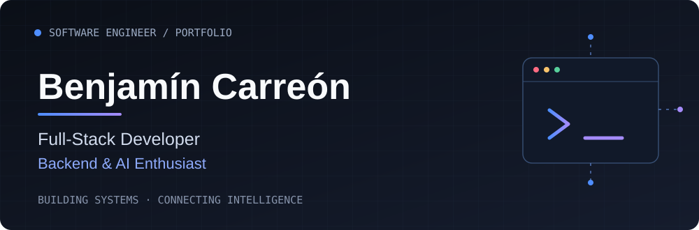

<!--
  BENJAMÍN CARREÓN — GITHUB PROFILE
  Repository: BCarreonC/BCarreonC
  Theme: Minimal Developer Portfolio
-->

  <picture>
    <source
      media="(prefers-color-scheme: dark)"
      srcset="./assets/hero-dark.svg"
    />
    <source
      media="(prefers-color-scheme: light)"
      srcset="./assets/hero-light.svg"
    />
    
  </picture>

   

  

    <strong>Software Engineer</strong> building scalable applications,
    intelligent systems and modern digital experiences.
  

  

    
    
    
  

 

## 01 / About Me

I'm a **Software Engineer** specializing in **Full-Stack Development**, with a strong focus on **Backend Engineering, Artificial Intelligence and Software Architecture**.

I design and develop RESTful APIs, scalable backend systems and modern web applications. I'm particularly interested in integrating **LLMs and autonomous AI agents** into real-world software solutions.

My experience includes enterprise applications, authentication systems, database modeling and AI-powered workflows.

- **Backend Engineering:** REST APIs, authentication, business logic and modular architectures.
- **AI Engineering:** LLM integrations, LangGraph workflows and API-connected agents.
- **Full-Stack Development:** Building applications from database architecture to user interfaces.
- **Software Design:** Maintainability, separation of concerns and continuous improvement.

 

## 02 / Tech Stack

Technologies and tools I use to design, develop and deploy software.

### Backend

  

`NestJS` · `Node.js` · `TypeScript` · `Python` · `FastAPI` · `Flask`

### Frontend

  

`React` · `JavaScript` · `TypeScript` · `Tailwind CSS` · `Vite`

### Databases

  

`MongoDB` · `PostgreSQL` · `SQLite`

### AI & Machine Learning

**LangGraph** · **LangChain** · **Ollama** · **LLM Integration** · **AI Agents**

Designing intelligent workflows that connect language models with external tools, APIs and application data.

### DevOps & Development Tools

  

`Docker` · `Git` · `GitHub` · `Postman` · `Railway` · `Vercel`

 

## 03 / Featured Projects

Selected projects focused on backend architecture, artificial intelligence, analytics and enterprise software.

---

### 01 — Medical AI Agent

**Healthcare Management & AI Integration**

A medical office management system designed to handle patients, doctors, appointments and consultations while integrating an independent AI agent service.

**Architecture**

- NestJS REST API for authentication, business logic and data management.
- FastAPI service for independent AI processing.
- LangGraph for AI agent orchestration and workflows.
- MongoDB for application data persistence.

**Tech Stack**

`NestJS` `TypeScript` `FastAPI` `Python` `LangGraph` `MongoDB` `Docker`

---

### 02 — ERP PULSAR

**Enterprise Resource Planning Desktop Application**

A desktop application designed to centralize business operations through a modular management interface.

**Key Modules**

- Inventory management.
- Project administration.
- Purchasing workflows.
- Reports and configuration.

**Tech Stack**

`Electron` `React` `TypeScript` `Vite`

---

### 03 — Recruitment System

**Recruitment Management REST API**

A backend system designed to organize recruitment workflows, candidates, job openings, applications and interviews.

**Key Features**

- JWT-based authentication.
- Candidate and job management.
- Application tracking.
- Interview management.
- Modular backend architecture.

**Tech Stack**

`NestJS` `TypeScript` `MongoDB` `JWT`

---

> Some projects may have private repositories or deployment restrictions. Additional implementation details are available upon request.

**[Explore my portfolio →](https://benjamincarreon.vercel.app/)**

 

## 04 / Currently Exploring

| Area | Focus |
|:---|:---|
| **AI Agents** | LLM tools, orchestration and autonomous workflows |
| **LangGraph** | Stateful AI systems and agent architectures |
| **Backend Architecture** | Modular design and maintainable systems |
| **Docker & Deployment** | Containerization and application delivery |
| **Scalable Systems** | Reliability, performance and system design |

 

  
    Benjamín Carreón · Software Engineer
     
    Building systems with curiosity and attention to detail.
  

